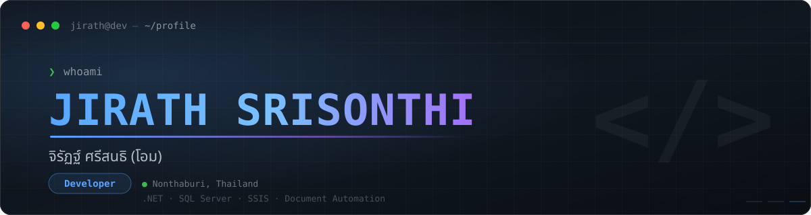

<div align="center">




<a href="https://github.com/Jirath-dev"></a>

<a href="https://github.com/Jirath-dev?tab=repositories"></a>


<!--
  ═══ เติมลิงก์จริงตรงนี้ แล้วลบเครื่องหมาย comment ด้านล่างออก ═══
  แทน YOUR-ID ด้วย LinkedIn ของคุณ และ YOUR@EMAIL ด้วยอีเมลจริง

<a href="https://www.linkedin.com/in/YOUR-ID/"></a>
<a href="mailto:YOUR@EMAIL"></a>
-->

</div>

* * *

### `> cat about.md`

```yaml
name       : จิรัฏฐ์ ศรีสนธิ (โอม) — Jirath Srisonthi
role       : Developer
location   : Nonthaburi, Thailand
focus      : [ enterprise .NET, SQL Server & SSIS, document automation, internal tools ]
philosophy : "สร้างเครื่องมือให้คนอื่นทำงานน้อยลง — วัดผลได้ก่อนเชื่อ"
status     : เปิดรับงานระบบภายในองค์กร / automate เอกสาร
```

### `> ls ~/selected-work`

| Project | What it does | Stack |
| :--- | :--- | :--- |
| **DKEFGenTool** | เครื่องมือสร้างฟอร์ม DevExpress `.repx` แบบกำหนดเอง | `C#` · `DevExpress` |
| **Pdf2Repx** | แปลงฟอร์ม PDF (แบบตรวจ VEC) → Report `.repx` อัตโนมัติ | `C#` · `PDF parsing` |
| **edi.dft.go.th** | ระบบออกหนังสือรับรองถิ่นกำเนิดสินค้า (FORM D/E) | `VB.NET` · `SQL Server` |
| **backoffice.dft.go.th** | ระบบหนังสือรับรอง ฝั่งเจ้าหน้าที่ | `VB.NET` · `SQL Server` |
| **WorkTrack** | ระบบบันทึก/ติดตามงานภายในทีม | `JavaScript` |
| **pdf-datadict** | สร้าง Data Dictionary (Excel) จาก PDF | `Python` |

### `> pip list --tech-stack`


      

### `> git log --stats`

<div align="center">


<picture>
  <source media="(prefers-color-scheme: dark)" srcset="https://raw.githubusercontent.com/Jirath-dev/Jirath-dev/output/snake-dark.svg" />
  <source media="(prefers-color-scheme: light)" srcset="https://raw.githubusercontent.com/Jirath-dev/Jirath-dev/output/snake.svg" />
  
</picture>


</div>

<!--
  หมายเหตุ: การ์ดสถิติจาก github-readme-stats เวอร์ชันสาธารณะจะนับเฉพาะ repo public
  ถ้าต้องการให้นับ private ด้วย ต้อง self-host เองบน Vercel พร้อม Personal Access Token
  และอย่าลืมเปิด Settings → Public profile → "Include private contributions on my profile"
  เพื่อให้กราฟ contribution (และอนิเมชันงู) แสดงกิจกรรมจาก repo private
-->
